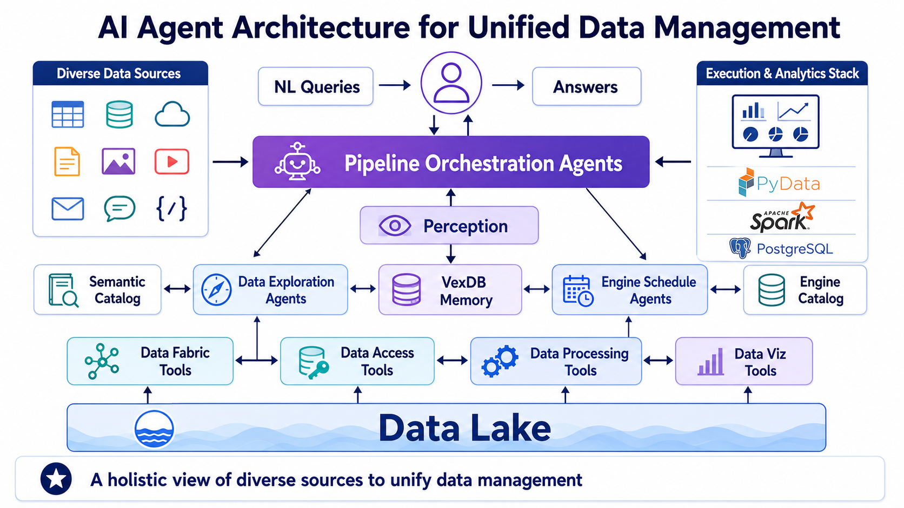
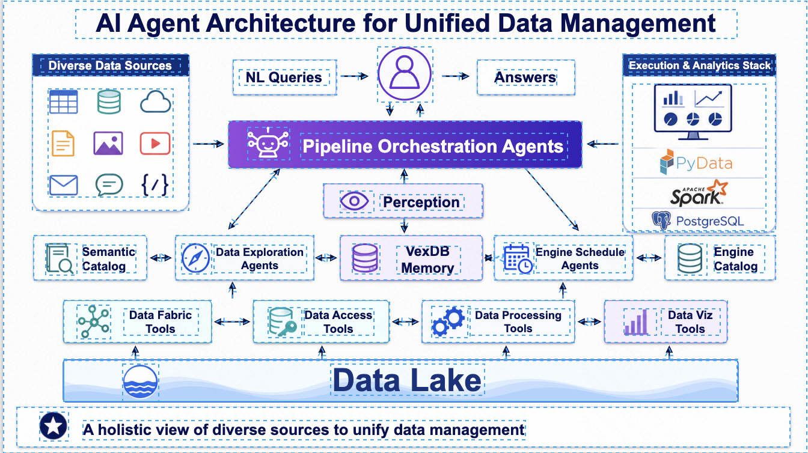
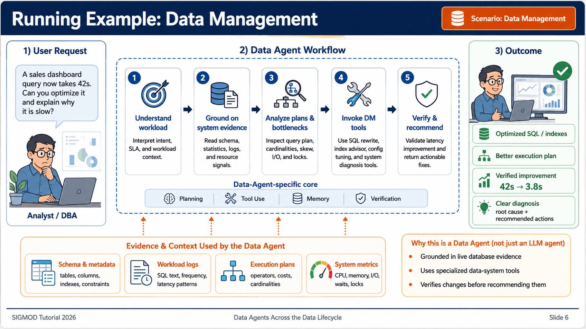
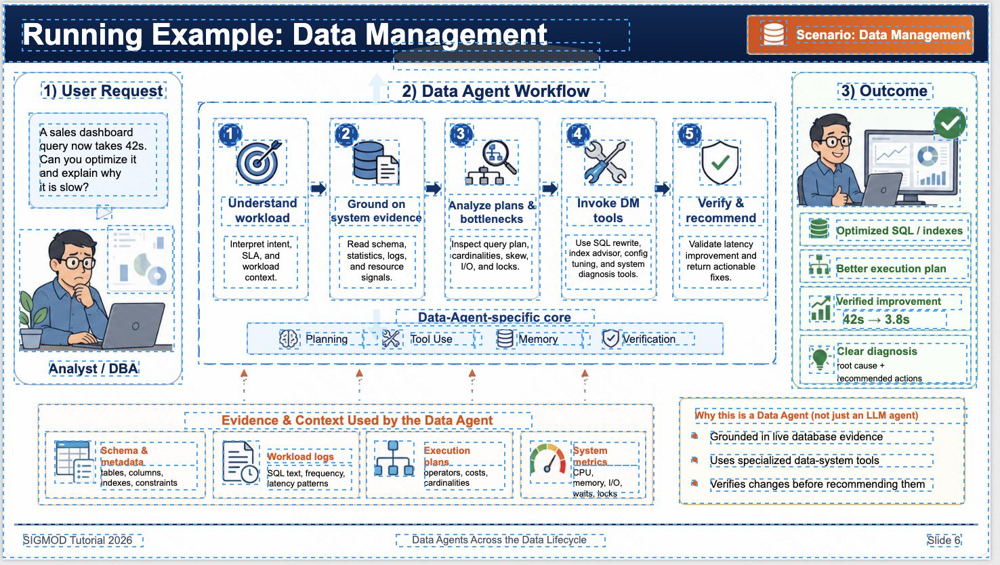
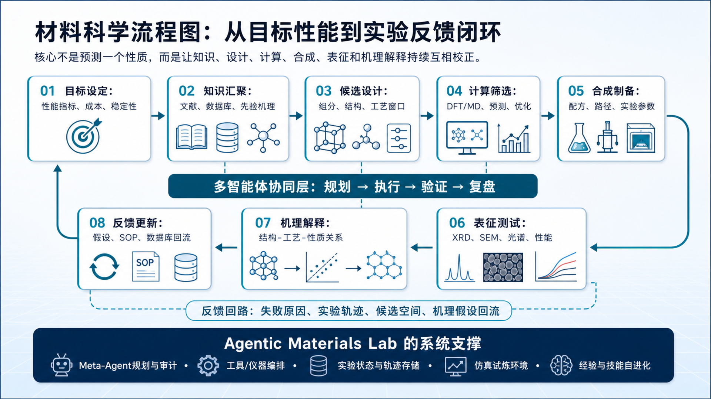
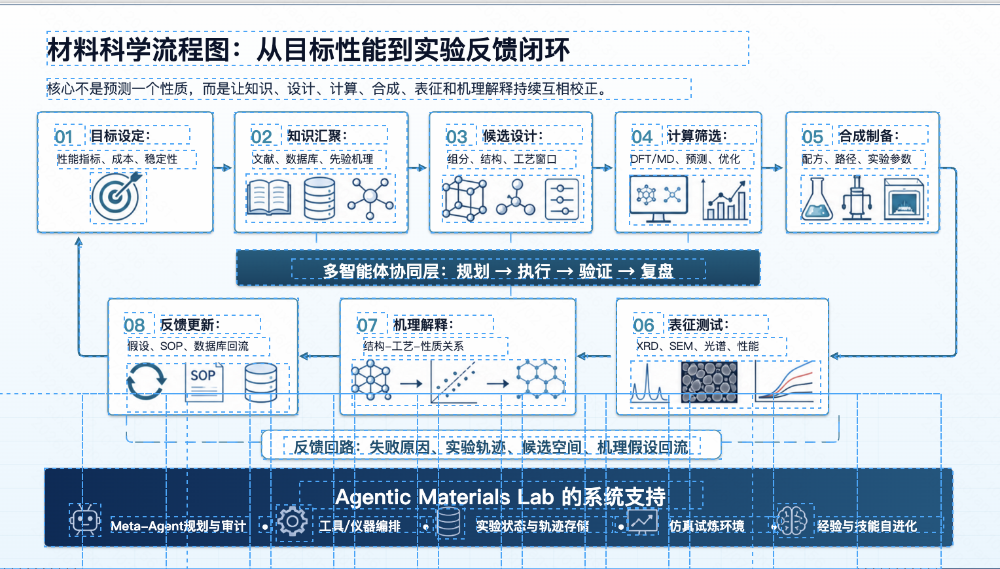

<div align="center">

# Draw.io Reconstruction Skill

[English](README.md) | [中文](README.zh-CN.md)

**A Codex skill for reconstructing diagram images into editable Draw.io files, with examples strongly recommended to be reproduced using Codex + GPT-5.5 xhigh.**

[](https://arxiv.org/abs/2605.15677)
[](https://huggingface.co/datasets/sxy1620348809/VCG-Bench)

</div>

This repository contains a Codex skill and helper scripts for converting reference diagram images into editable `.drawio` files. It is the practical reconstruction workflow used in the VCG-Bench release examples: an agent inspects a reference image, creates a visible-element inventory, rebuilds text and structure with Draw.io primitives, uses crops or SVG where appropriate, exports a PNG preview, and verifies the result. The bundled examples are packaged so others can reproduce them from the original PNG inputs. For faithful reproduction of the displayed examples, we strongly recommend using Codex + GPT-5.5 xhigh mode; weaker models or lower reasoning modes may not match the same visual fidelity.

The companion benchmark repository is released at https://github.com/sxy1499894281/VCG-Bench.

## Recommended Reproduction Configuration

The example reconstructions in this repository are best reproduced with the following reference configuration:

- Runtime: Codex
- Model/mode: GPT-5.5 xhigh
- Input: the original PNG files in `examples/`
- Output: editable `.drawio` files plus exported preview PNGs

This is the configuration we recommend for reproducing the README case images. Other runtimes, models, or lower reasoning settings can be used for experimentation, but they should not be treated as equivalent reproduction settings because they may miss small visual elements, drift in layout, or produce lower-fidelity Draw.io structure.

When reproducing, use `examples/<name>.png` as the source image and export the preview to a separate file such as `examples/<name>.preview.png` so the original input remains unchanged.

## What Is Included

| Path | Purpose |
|---|---|
| `SKILL.md` | The Codex skill instructions. This is the file Codex reads when the skill is installed. |
| `scripts/batch_manifest.py` | Build a manifest for a folder of input images. |
| `scripts/batch_verify.py` | Validate a batch of `.drawio` outputs and exported previews. |
| `scripts/check_drawio.py` | Check `.drawio` XML structure, embedded images, and common reconstruction issues. |
| `scripts/export_drawio.py` | Export `.drawio` files to PNG using Draw.io Desktop/CLI. |
| `scripts/crop_assist.py` | Assist with extracting image crops from complex reference diagrams. |
| `requirements.txt` | Optional Pillow dependency used by `crop_assist.py`. |
| `agents/openai.yaml` | Example agent configuration metadata. |
| `examples/` | Original PNG inputs and example reconstructed `.drawio` files. |
| `assets/` | README case images. |

## Reconstruction Cases

The examples below show one-round Codex + GPT-5.5 xhigh + skill reconstruction outputs. The left image is the original diagram, and the right image is a README display copy of the exported PNG from the reconstructed `.drawio` file.

<table>
  <tr>
    <th width="50%">Original</th>
    <th width="50%">Reconstructed Draw.io Export</th>
  </tr>
  <tr>
    <td></td>
    <td></td>
  </tr>
  <tr>
    <td></td>
    <td></td>
  </tr>
  <tr>
    <td></td>
    <td></td>
  </tr>
</table>

Example source images and editable outputs are available at:

```text
examples/data_lake.png
examples/data_lake.drawio
examples/data_man.png
examples/data_man.drawio
examples/data_sci2.png
examples/data_sci2.drawio
```

## Installation As A Codex Skill

Install the directory that contains this `SKILL.md`, not the Supervisor-Skills repository root. With Codex, the most direct prompt is:

```text
Use $skill-installer to install https://github.com/HKUSTDial/Supervisor-Skills/tree/main/others/drawio-reconstruction.
```

For a manual user-level installation, copy or symlink this skill directory into a Codex skill discovery location:

```bash
mkdir -p ~/.agents/skills
ln -s /absolute/path/to/Supervisor-Skills/others/drawio-reconstruction ~/.agents/skills/drawio-reconstruction
```

Codex also supports installer-managed and administrator-managed skill locations. The skill resolves helper scripts from its actual installed directory and does not require a fixed home-directory path. Then ask Codex to use `$drawio-reconstruction` for a diagram image or a folder of images. If a newly installed skill does not appear, restart Codex.

## Requirements

- Codex or another agent that can follow `SKILL.md`.
- Python 3.10+ for the helper scripts.
- Pillow for `crop_assist.py` only. Install it with `python -m pip install -r requirements.txt` from this skill directory.
- Draw.io Desktop/CLI for exporting `.drawio` files to PNG.

macOS:

```bash
brew install --cask drawio
```

Ubuntu/Debian:

Download the matching `.deb` or AppImage from the official [drawio-desktop releases](https://github.com/jgraph/drawio-desktop/releases). For a downloaded `.deb`:

```bash
sudo apt install ./drawio-amd64-*.deb
```

For an AppImage or another non-standard installation, make the file executable and set its path:

```bash
chmod +x /absolute/path/to/drawio.AppImage
export DRAWIO_PATH=/absolute/path/to/drawio.AppImage
```

Windows PowerShell:

```powershell
$env:DRAWIO_PATH = "C:\Program Files\draw.io\draw.io.exe"
```

`export_drawio.py` checks `--drawio-path` first, then `DRAWIO_PATH`, common installation paths, and finally `PATH`. An explicit one-off path can be passed as:

```bash
python scripts/export_drawio.py examples/data_lake.drawio examples/data_lake.preview.png --drawio-path /absolute/path/to/drawio
```

## Batch Workflow

Create a manifest for a folder of images:

```bash
python scripts/batch_manifest.py path/to/images --output-dir path/to/output --write
```

For each manifest entry, the agent should create:

```text
<stem>.drawio
<stem>.png
<stem>.audit.md
```

Verify the batch:

```bash
python scripts/batch_verify.py path/to/output/drawio_batch_manifest.json
```

Export a single `.drawio` file:

```bash
python scripts/export_drawio.py examples/data_lake.drawio examples/data_lake.preview.png
```

Check a `.drawio` file:

```bash
python scripts/check_drawio.py examples/data_lake.drawio
```

## Reconstruction Principles

The skill prioritizes visual fidelity to the reference image. It uses native Draw.io elements for editable text and structure, SVG or native shapes for simple icons, and image crops for complex, style-specific, or scene-like visual elements. Completion requires visual comparison against the reference, not only successful XML export.

Key quality gates:

- Every visible element should be inventoried before final delivery.
- Text and structural geometry should remain editable when practical.
- Complex artwork should be cropped or carefully repaired instead of replaced by generic icons.
- Exported PNG previews must be inspected for missing elements, crop seams, blur, and layout drift.
- The audit file should record unresolved defects instead of claiming perfect reconstruction.

## Relation To VCG-Bench

VCG-Bench studies visual-centric structured generation and editing with `mxGraph` XML. This skill is a practical agent workflow for one part of that problem: reconstructing high-fidelity editable Draw.io diagrams from reference images.

Relevant resources:

- Homepage: https://sxy1499894281.github.io/VCG-Bench/
- Paper: https://arxiv.org/abs/2605.15677
- Dataset: https://huggingface.co/datasets/sxy1620348809/VCG-Bench
- Code: https://github.com/sxy1499894281/VCG-Bench

## License

This skill repository is released under the [MIT License](LICENSE).

## Citation

If you use this skill or the companion benchmark in research, please cite VCG-Bench:

```bibtex
@misc{su2026vcgbenchunifiedvisualcentricbenchmark,
      title={VCG-Bench: Towards A Unified Visual-Centric Benchmark for Structured Generation and Editing}, 
      author={Xiaoyan Su and Peijie Dong and Zhenheng Tang and Song Tang and Yuyao Zhai and Kaitao Lin and Liang Chen and Gai Yuhang and Yuyu Luo and Qiang Wang and Xiaowen Chu},
      year={2026},
      eprint={2605.15677},
      archivePrefix={arXiv},
      primaryClass={cs.CL},
      url={https://arxiv.org/abs/2605.15677}, 
}
```
