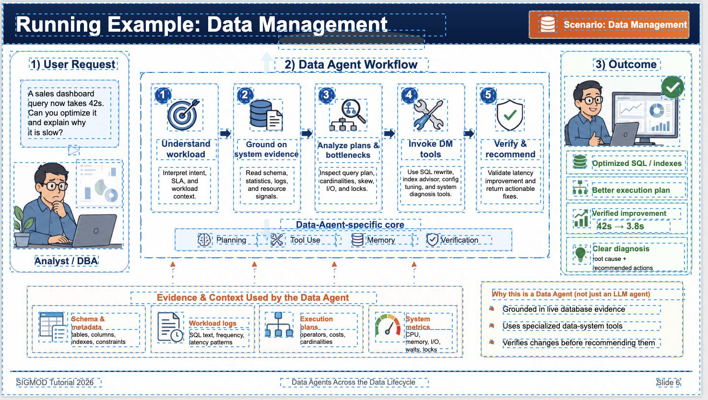
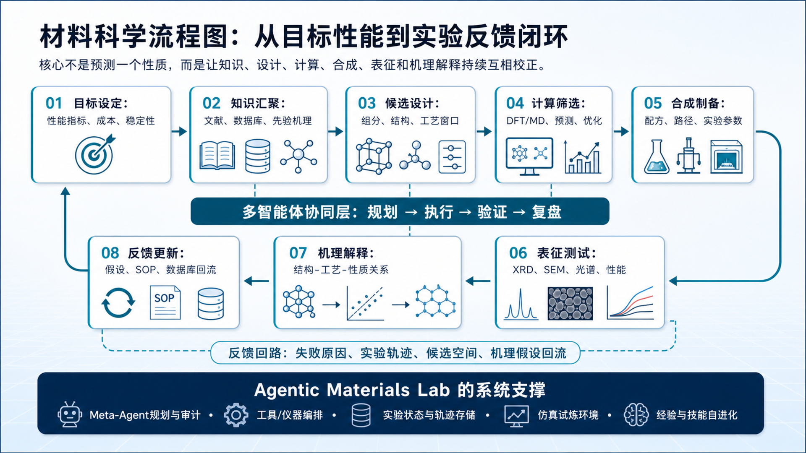
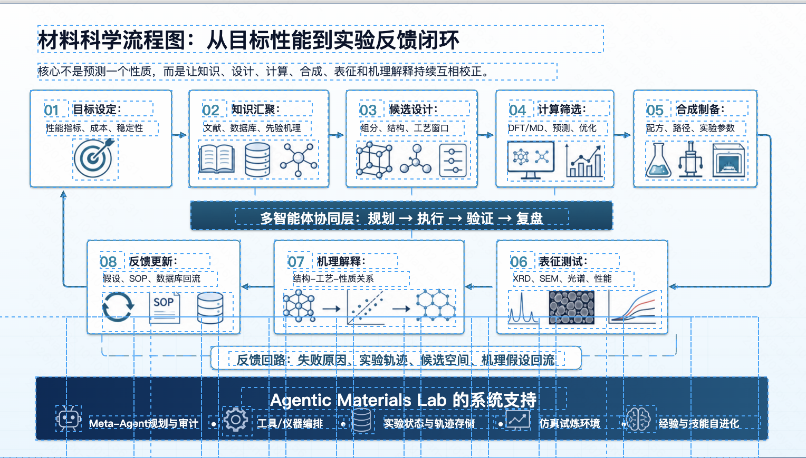

<div align="center">

# Draw.io Reconstruction Skill

[English](README.md) | [中文](README.zh-CN.md)

**一个用于将图像中的图示重建为可编辑 Draw.io 文件的 Codex skill。若要较稳定地复现仓库中的示例，建议使用 Codex + GPT-5.5 xhigh。**

[](https://arxiv.org/abs/2605.15677)
[](https://huggingface.co/datasets/sxy1620348809/VCG-Bench)

</div>

这个仓库包含一个 Codex skill，以及一组辅助脚本，用于把参考图中的图示转换成可编辑的 `.drawio` 文件。它对应的是 VCG-Bench 发布示例中的实际重建流程：agent 先检查参考图、建立可见元素清单，再用 Draw.io 原生图元重建文本和结构，在合适的时候使用裁剪图或 SVG，导出 PNG 预览，并对结果进行验证。仓库中自带了示例，便于其他人基于原始 PNG 输入进行复现。若希望尽量接近 README 中展示的重建效果，建议使用 Codex + GPT-5.5 xhigh；更弱的模型或更低的推理模式，视觉保真度通常会明显下降。

配套 benchmark 仓库地址：
https://github.com/sxy1499894281/VCG-Bench

## 推荐复现配置

本仓库中的示例重建，推荐使用以下参考配置：

- Runtime：Codex
- Model / mode：GPT-5.5 xhigh
- 输入：`examples/` 目录中的原始 PNG
- 输出：可编辑的 `.drawio` 文件和导出的 PNG 预览图

这是我们建议用于复现 README 案例图的配置。你也可以用其他运行时、模型或更低的推理设置来做实验，但不应把这些配置视为等价复现条件，因为它们更容易遗漏小元素、在布局上漂移，或者生成保真度更低的 Draw.io 结构。

复现时，建议把 `examples/<name>.png` 作为源图，并把导出预览图写到单独文件，例如 `examples/<name>.preview.png`，这样不会覆盖原始输入。

## 仓库内容

| 路径 | 用途 |
|---|---|
| `SKILL.md` | Codex skill 的说明文件。安装 skill 后，Codex 实际读取的就是这个文件。 |
| `scripts/batch_manifest.py` | 为一批输入图片生成 manifest。 |
| `scripts/batch_verify.py` | 校验一批 `.drawio` 输出及其导出的预览图。 |
| `scripts/check_drawio.py` | 检查 `.drawio` XML 结构、嵌入图像，以及常见重建问题。 |
| `scripts/export_drawio.py` | 通过 Draw.io Desktop/CLI 将 `.drawio` 导出为 PNG。 |
| `scripts/crop_assist.py` | 辅助从复杂参考图中裁出局部图像。 |
| `requirements.txt` | `crop_assist.py` 使用的可选 Pillow 依赖。 |
| `agents/openai.yaml` | 示例 agent 配置元数据。 |
| `examples/` | 原始 PNG 输入，以及对应的示例 `.drawio` 文件。 |
| `assets/` | README 中展示案例所需的图片资源。 |

## 重建案例

下面的示例展示的是单轮 Codex + GPT-5.5 xhigh + skill 的重建结果。左侧是原始图，右侧是由重建后的 `.drawio` 导出的 PNG，并作为 README 展示图使用。

<table>
  <tr>
    <th width="50%">原图</th>
    <th width="50%">重建后的 Draw.io 导出图</th>
  </tr>
  <tr>
    <td></td>
    <td></td>
  </tr>
  <tr>
    <td></td>
    <td></td>
  </tr>
  <tr>
    <td></td>
    <td></td>
  </tr>
</table>

示例输入图和可编辑输出位于：

```text
examples/data_lake.png
examples/data_lake.drawio
examples/data_man.png
examples/data_man.drawio
examples/data_sci2.png
examples/data_sci2.drawio
```

## 作为 Codex Skill 安装

应安装包含当前 `SKILL.md` 的目录，不要把 Supervisor-Skills 仓库根目录当成一个 skill 安装。使用 Codex 时，可直接发送：

```text
Use $skill-installer to install https://github.com/HKUSTDial/Supervisor-Skills/tree/main/others/drawio-reconstruction.
```

如需手动安装，可把这个 skill 目录复制或软链接到 Codex 的 skill 发现目录：

```bash
mkdir -p ~/.agents/skills
ln -s /absolute/path/to/Supervisor-Skills/others/drawio-reconstruction ~/.agents/skills/drawio-reconstruction
```

Codex 也支持由 installer 或管理员管理的其他 skill 位置。本 skill 会根据实际安装目录定位辅助脚本，不依赖固定的 home 路径。之后让 Codex 对某张图或图片文件夹使用 `$drawio-reconstruction` 即可。如果新安装的 skill 没有出现，请重启 Codex。

## 依赖要求

- Codex，或其他能遵循 `SKILL.md` 的 agent。
- Python 3.10+，用于运行辅助脚本。
- 仅 `crop_assist.py` 需要 Pillow；在本 skill 目录执行 `python -m pip install -r requirements.txt` 即可安装。
- Draw.io Desktop/CLI，用于把 `.drawio` 导出为 PNG。

macOS：

```bash
brew install --cask drawio
```

Ubuntu / Debian：

从官方 [drawio-desktop releases](https://github.com/jgraph/drawio-desktop/releases) 下载匹配平台的 `.deb` 或 AppImage。下载 `.deb` 后可执行：

```bash
sudo apt install ./drawio-amd64-*.deb
```

使用 AppImage 或其他非标准安装位置时，赋予执行权限并设置路径：

```bash
chmod +x /absolute/path/to/drawio.AppImage
export DRAWIO_PATH=/absolute/path/to/drawio.AppImage
```

Windows PowerShell：

```powershell
$env:DRAWIO_PATH = "C:\Program Files\draw.io\draw.io.exe"
```

`export_drawio.py` 会依次检查 `--drawio-path`、`DRAWIO_PATH`、常见安装位置和 `PATH`。也可以为单次导出显式指定：

```bash
python scripts/export_drawio.py examples/data_lake.drawio examples/data_lake.preview.png --drawio-path /absolute/path/to/drawio
```

## 批处理工作流

为一个图片目录创建 manifest：

```bash
python scripts/batch_manifest.py path/to/images --output-dir path/to/output --write
```

对于 manifest 中的每个条目，agent 应产出：

```text
<stem>.drawio
<stem>.png
<stem>.audit.md
```

验证批处理结果：

```bash
python scripts/batch_verify.py path/to/output/drawio_batch_manifest.json
```

导出单个 `.drawio` 文件：

```bash
python scripts/export_drawio.py examples/data_lake.drawio examples/data_lake.preview.png
```

检查单个 `.drawio` 文件：

```bash
python scripts/check_drawio.py examples/data_lake.drawio
```

## 重建原则

这个 skill 的首要目标是尽可能贴近参考图的视觉效果。对于文本和结构，它优先使用 Draw.io 原生元素；对于简单图标，可使用 SVG 或原生形状；对于复杂、风格强或带场景感的视觉元素，则优先使用图像裁剪。是否“完成”，不应只看 XML 能否导出成功，还必须和参考图做视觉对比。

核心质量门槛：

- 在最终交付前，应盘点每一个可见元素。
- 文本和结构几何在可行时应保持可编辑。
- 复杂视觉元素应裁剪或谨慎修补，而不是直接替换成泛化图标。
- 导出的 PNG 预览图必须检查缺失元素、裁剪接缝、模糊和布局漂移。
- audit 文件应记录尚未解决的缺陷，而不是宣称“完美重建”。

## 与 VCG-Bench 的关系

VCG-Bench 关注的是围绕 `mxGraph` XML 的视觉中心化结构生成与编辑问题。这个 skill 是其中一类实际工作流：从参考图出发，重建高保真、可编辑的 Draw.io 图示。

相关资源：

- Homepage: https://sxy1499894281.github.io/VCG-Bench/
- Paper: https://arxiv.org/abs/2605.15677
- Dataset: https://huggingface.co/datasets/sxy1620348809/VCG-Bench
- Code: https://github.com/sxy1499894281/VCG-Bench

## 许可证

这个 skill 仓库采用 [MIT License](LICENSE) 发布。

## 引用

如果你在研究中使用了这个 skill 或它配套的 benchmark，请引用 VCG-Bench：

```bibtex
@misc{su2026vcgbenchunifiedvisualcentricbenchmark,
      title={VCG-Bench: Towards A Unified Visual-Centric Benchmark for Structured Generation and Editing}, 
      author={Xiaoyan Su and Peijie Dong and Zhenheng Tang and Song Tang and Yuyao Zhai and Kaitao Lin and Liang Chen and Gai Yuhang and Yuyu Luo and Qiang Wang and Xiaowen Chu},
      year={2026},
      eprint={2605.15677},
      archivePrefix={arXiv},
      primaryClass={cs.CL},
      url={https://arxiv.org/abs/2605.15677}, 
}
```
